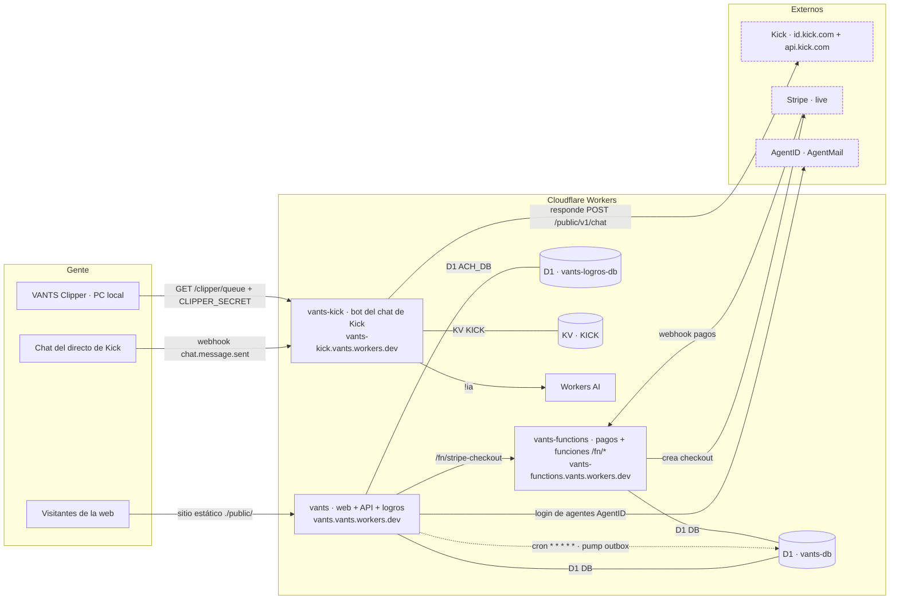
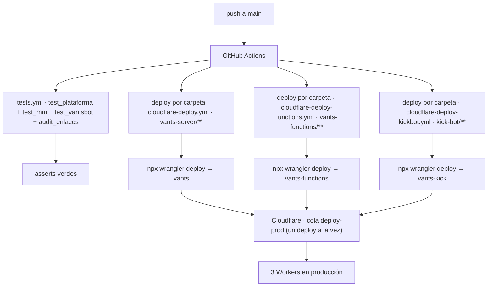

# VANTS GAMES · Arena competitiva + ecosistema en vivo 🇻🇪


Plataforma de esports estilo torneos (referencia de UX: strafe.com): calendario de torneos
por juego y estado, partidas en vivo, ranking, brackets, equipos, jugadores, noticias,
búsqueda, tienda y membresías — con login **Auth0**, login de agentes **AgentID**, datos en
**Cloudflare D1** y despliegue automático en **Cloudflare Workers**. Alrededor de la arena
vive el ecosistema en vivo: el **bot del chat de Kick** (canal feispla) y el agente local
**VANTS Clipper** que corta y publica los mejores momentos.

**Web:** https://vants.vants.workers.dev · **Contacto:** vants@agentmail.to

## Producción: 3 Workers de Cloudflare

| Worker | Carpeta | URL pública | Qué hace | Deploy |
| --- | --- | --- | --- | --- |
| `vants` | `vants-server/` | https://vants.vants.workers.dev | Web estática (arena, torneos, membresías, tienda, legales) + API + login AgentID + motor de logros (ACH_DB) + outbox cada minuto | `cloudflare-deploy.yml` |
| `vants-functions` | `vants-functions/` | https://vants-functions.vants.workers.dev | Las funciones `/fn/*`: stripe-checkout (live) y webhook, vantsdata, vantsbot, mm, linker, discord-notify, supervisor | `cloudflare-deploy-functions.yml` |
| `vants-kick` | `kick-bot/` | https://vants-kick.vants.workers.dev | Bot del chat de Kick: IA con memoria, comandos `!`, `!clip` y cola del VANTS Clipper | `cloudflare-deploy-kickbot.yml` |

## Arquitectura en producción

<!-- MDSA:inicio id=arquitectura · generado por tools/sync-diagrams.mjs (no editar a mano: se sobreescribe) -->

  <!-- MDSA:fin id=arquitectura -->

El diagrama de arriba lo genera el **Mermaid Diagram Sync Assistant** leyendo los
`wrangler.toml` reales — si un binding cambia, el diagrama cambia con él (ver MDSA más abajo).

## Despliegue: push a `main` y el CI hace el resto

<!-- MDSA:inicio id=pipeline · generado por tools/sync-diagrams.mjs (no editar a mano: se sobreescribe) -->

  <!-- MDSA:fin id=pipeline -->

| Workflow | Disparador | Qué hace |
| --- | --- | --- |
| `tests.yml` | push/PR con `scripts/ vants-server/ neon-functions/ db/ services/ tests/` | suites de asserts del monorepo |
| `cloudflare-deploy.yml` | push con `vants-server/**` | deploy del Worker `vants` |
| `cloudflare-deploy-functions.yml` | push con `vants-functions/**` | deploy del Worker `vants-functions` |
| `cloudflare-deploy-kickbot.yml` | push con `kick-bot/**` | deploy del Worker `vants-kick` + instala `CLIPPER_SECRET` |
| `diagram-sync.yml` (MDSA) | push con `tools/ README.md kick-bot/README.md **/wrangler.toml` | resincroniza los diagramas de los README |
| `monitor.yml` | cada 30 minutos | monitor de salud del ecosistema |
| `mejoras-discord.yml` | push a `main` | aviso de mejoras a Discord |
| `android-build.yml` | push/PR con `android/**` | build de la app Android |
| `faceit-sync.yml` / `faceit-xp.yml` | manual (pausados) | integración FACEIT, pendiente de migrar a D1 |

Regla de oro: **un deploy a la vez**. Los tres workflows de deploy comparten la cola
`concurrency: deploy-prod` — lección aprendida: 3 deploys simultáneos contra la misma
cuenta de Cloudflare acaban en rate limit (10429).

## Mermaid Diagram Sync Assistant (MDSA)

**El problema.** Los diagramas de arquitectura envejecen mal: alguien añade una base de
datos, cambia un cron o mueve un endpoint, y el README se queda contando un sistema que
ya no existe. Nadie actualiza el dibujo porque hay que hacerlo a mano.

**La idea.** En este repo la configuración real YA está escrita: cada Worker declara sus
bindings, assets, crons y vars en su `wrangler.toml`. El MDSA aprovecha eso: **genera los
diagramas Mermaid leyendo esos archivos**, así el dibujo no puede mentir.

**Cómo funciona, paso a paso.**

1. `tools/sync-diagrams.mjs` lee `vants-server/wrangler.toml`, `vants-functions/wrangler.toml`
   y `kick-bot/wrangler.toml`. De ahí salen los **nodos reales**: nombre del Worker, bases
   D1, namespaces KV, Workers AI, carpeta de assets y crons.
2. La **topología** (quién habla con quién: checkout→Stripe, chat→bot, clipper→cola…) es la
   única semántica que no vive en ningún toml, así que se declara en el propio script. Cada
   arista se dibuja solo si la configuración que la justifica existe: si quitas el binding
   `AI` del bot, la arista `!ia → Workers AI` desaparece; si borras `kick-bot/`, su nodo y
   todas sus aristas desaparecen solos.
3. El script renderiza cada diagrama y lo **inyecta entre marcadores** dentro de los README:

   ```html
   <!-- MDSA:inicio id=ejemplo -->
   ...aquí va el diagrama generado...
   <!-- MDSA:fin id=ejemplo -->
   ```

   Lo que haya entre los marcadores es del asistente: editarlo a mano se pierde en la
   siguiente sincronización. Fuera de los marcadores, el README es tuyo.
4. `.github/workflows/diagram-sync.yml` corre en cada push a `main` que toque `tools/`,
   los README sincronizados o cualquier `wrangler.toml`, ejecuta el script y, **si el
   resultado cambia**, hace un commit automático (`[skip ci]`, para no disparar deploys
   ni avisos). Resultado: cambiaste un `wrangler.toml` → push → el diagrama se actualiza
   solo en el README.

**Modos de uso.**

```bash
node tools/sync-diagrams.mjs           # escribe los README con los diagramas al día
node tools/sync-diagrams.mjs --check   # no escribe; exit 1 si algo está desincronizado (modo CI)
```

**Qué se sincroniza solo y qué no.**

| Cambio en el repo | Efecto en los diagramas |
| --- | --- |
| Añadir/quitar un binding D1 o KV en un `wrangler.toml` | nodo nuevo/eliminado en el siguiente push |
| Cambiar un cron o la carpeta de assets | etiqueta del nodo/arista actualizada |
| Renombrar un Worker o añadir uno nuevo | nodos regenerados con el nombre real |
| Borrar la carpeta de un Worker | nodo y aristas desaparecen (con aviso en el log del CI) |
| Documentar en MDSA un comando `!` que no existe en `worker.js` | aviso en el CI: «documentado pero no aparece en el código» |
| La topología entre actores (quién llama a quién) | se declara en `tools/sync-diagrams.mjs` — es la parte manual, deliberada |

**Cómo añadir un diagrama sincronizado nuevo.**

1. En el README destino, pon los marcadores con un id nuevo:
   `<!-- MDSA:inicio id=mi-diagrama -->` y `<!-- MDSA:fin id=mi-diagrama -->`.
2. En `tools/sync-diagrams.mjs`, escribe una función `buildMiDiagrama()` que devuelva el
   Mermaid y regístrala en el objeto `DIAGRAMAS` (clave = id de los marcadores).
3. Añade el archivo+id a la lista `DESTINOS` del script.
4. Corre `node tools/sync-diagrams.mjs` en local, revisa el diff y push. El CI lo mantiene
   a partir de ahí.

**Archivos involucrados:** `tools/sync-diagrams.mjs` (motor, sin dependencias) ·
`.github/workflows/diagram-sync.yml` (cuándo corre) · marcadores `MDSA:*` en `README.md`
(`arquitectura`, `pipeline`) y `kick-bot/README.md` (`bot-flujo`).

## Estructura del monorepo

```
├── README.md                   ← este archivo (diagramas MDSA dentro)
├── vants-server/               ← Worker `vants`: web + API + logros (ver su README)
│   ├── worker.js · server.js   ← entrada del Worker + app
│   ├── *-core.js               ← lógica pura compartida Worker↔tests (ESM)
│   └── public/                 ← frontend servido (espejo ×3 con raíz y public/)
├── vants-functions/            ← Worker `vants-functions`: /fn/* pagos y funciones (README propio)
├── kick-bot/                   ← Worker `vants-kick`: bot del chat de Kick (README propio)
├── vants-bus/                  ← bus de eventos (inscription.created, clip.published, match.finished)
├── bot/                        ← bot ORION de Discord (Python)
├── services/                   ← matchmaking y servicios auxiliares
├── neon-functions/             ← legado Neon → ya migrado a vants-functions (D1)
├── monitor/                    ← monitor de salud (workflow monitor.yml cada 30 min)
├── android/                    ← app Android (workflow android-build.yml)
├── db/migrations/              ← SQL idempotente (se aplican en orden por nombre)
├── scripts/                    ← tests, auditoría de enlaces, scraper VLR, utilidades
├── tests/ · docs/ · architecture/ · product/ · repos/ (docs *.mdx)
├── PROJECT_STATUS.md           ← estado vivo de la misión
├── DECISIONS.md                ← decisiones técnicas y sus motivos
├── SECURITY.md                 ← política de seguridad
└── .github/workflows/          ← CI: tests, 3 deploys Cloudflare, MDSA, monitor, android…
```

## Requisitos previos

- Node 20+ (para tests y wrangler).
- Cuenta Cloudflare con los Workers `vants`, `vants-functions` y `vants-kick` (deploy automático por CI).
- Proyecto D1 `vants-db` (+ `vants-logros-db` para el motor de logros) con las migraciones aplicadas.
- Opcional en local: `npm i -g wrangler`.

## Arranque local

```bash
git clone https://github.com/VANTSGAMES/Vantsgames.git && cd Vantsgames

# web + API en local (sirve el frontend + las rutas reales)
cd vants-server && npm install && npx wrangler dev --port 8787
# → http://127.0.0.1:8787
```

No hay build del frontend: los archivos estáticos se sirven tal cual (espejo ×3:
raíz / `public/` / `vants-server/public/` — mantener los tres sincronizados).

## Pruebas

```bash
node scripts/test_plataforma.js    # lógica de la plataforma + integración
node scripts/test_mm_fase4.js      # matchmaking
node scripts/test_vantsbot.js      # bot / agente
node scripts/test_mm_neon.js       # mm legado
node scripts/audit_enlaces.js      # crawler interno de enlaces rotos
npm run test:e2e                   # Playwright
```

## Migraciones

Las aplica el CI en orden por nombre de archivo; son idempotentes. En manual: ejecutar
los `db/migrations/NN-*.sql` en orden contra `vants-db`.

## Secretos (nombres y dónde viven — nunca valores)

| Secreto | Dónde | Para qué |
| --- | --- | --- |
| `CLOUDFLARE_API_TOKEN` | secret del repo GitHub | deploys de los 3 Workers por CI |
| `CLIPPER_SECRET` | secret del repo → secret del Worker `vants-kick` | cola `GET /clipper/queue` del VANTS Clipper |
| `STRIPE_SECRET_KEY` | secret del repo → secret del Worker `vants-functions` | pagos live (verificar: `GET /fn/stripe-checkout/`) |
| `KICK_CLIENT_SECRET` | secret del Worker `vants-kick` | OAuth de Kick (id.kick.com) |
| `AGENTID_CLIENT_SECRET`, `VANTS_SESION_SEC` | secrets del Worker `vants` | login de agentes AgentID y sesiones |
| `VANTS_BUS_SECRET` | secret del Worker `vants` | publicar en vants-bus (sin él, apagado y sin romper nada) |
| `DISCORD_*`, `FACEIT_API_KEY` | secrets de `vants-functions` / repo | Discord y FACEIT (ver README de vants-functions) |

## Integraciones externas

- **Auth0** (`vants.eu.auth0.com`): login SPA de personas; el JWT decide el acceso.
- **AgentID (AgentMail)**: login de agentes de IA (`/.well-known/oauth-client.json` expone el registro).
- **Kick** (`id.kick.com` + `api.kick.com`): OAuth del bot, webhooks de chat y envío de mensajes.
- **Stripe (live)**: membresías y pase — checkout + webhook en `vants-functions`.
- **Discord**: notificaciones y bot ORION.
- **FACEIT / vlr.gg**: resultados y agenda esports.

## Seguridad y contacto

- Contacto único: **vants@agentmail.to** · Legales: `/privacidad` y `/terminos`.
- Todo lo sensible va en GitHub Secrets / secrets del Worker; nada de secretos en el repo
  (es público) ni en `[vars]`. Detalles: `SECURITY.md`.
- Si un token aparece en el chat o en un log: rotarlo inmediatamente.

## Estado y decisiones

`PROJECT_STATUS.md` (estado vivo con evidencia) · `DECISIONS.md` (el porqué de cada
decisión) · `IMPLEMENTATION_PLAN.md` (plan por fases).
