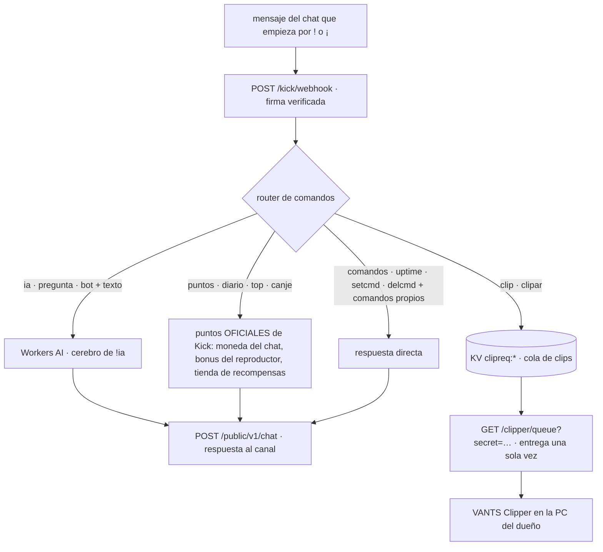

# vants-kick · Bot del chat de Kick (VANTS GAMES)

Worker de Cloudflare que vive en el chat del canal **feispla** (id `4972430`):
escucha los mensajes del directo, responde comandos `!`, conversa con IA y
memoria, y alimenta al agente local **VANTS Clipper** con los pedidos de clip.

- **OAuth 2.1 + PKCE** contra `id.kick.com` (scopes: `user:read channel:read chat:write events:subscribe`).
- **Webhook** `chat.message.sent` (v1) con firma verificada (403 `firma_invalida` si no).
- **Respuestas** vía `POST /public/v1/chat` de la API de Kick.
- **KV** (binding `KICK`): tokens OAuth, memoria de la IA, comandos personalizados y pedidos de clip.
- **Workers AI** (binding `AI`): el cerebro de `!ia`.

## Flujo de un mensaje

<!-- MDSA:inicio id=bot-flujo · generado por tools/sync-diagrams.mjs (no editar a mano: se sobreescribe) -->

  <!-- MDSA:fin id=bot-flujo -->

## Comandos (prefijo `!` o `¡`)

| Comando | Qué hace |
| --- | --- |
| `!ia` · `!pregunta` · `!bot <texto>` | pregunta al cerebro IA (Workers AI) |
| `!puntos` | explica los **puntos OFICIALES de Kick**: la moneda junto al chat, el bonus del reproductor y la tienda de recompensas |
| `!diario` | recuerda el bonus diario oficial (botón del reproductor) |
| `!top` | los más activos del chat (actividad, no puntos) |
| `!canje` · `!canjear` | guía a la tienda de recompensas del canal |
| `!clip` · `!clipar` | registra tu pedido de clip en la cola del VANTS Clipper |
| `!comandos` | lista los comandos disponibles |
| `!uptime` | cuánto lleva el servicio en marcha |
| `!setcmd` / `!delcmd` (solo dueño) | comandos personalizados del canal |

> **¿Por qué el bot no reparte puntos propios?** Los puntos son los OFICIALES de
> Kick y la API pública no permite leer saldos ni otorgarlos: el bot los menciona
> y guía a la moneda, el bonus y la tienda. La lista de comandos del diagrama la
> verifica el MDSA contra `worker.js` (avisa en el CI si se documenta uno inexistente).

## Rutas HTTP

| Ruta | Qué hace |
| --- | --- |
| `GET /` | info JSON del servicio y sus rutas |
| `GET /kick/authorize` | inicia el OAuth (PKCE) |
| `GET /kick/callback` | intercambia el código por tokens y los guarda en KV |
| `POST /kick/webhook` | recibe los eventos de chat (firma verificada) |
| `GET /kick/health` | diagnóstico: autorizado, token vigente, suscripción activa |
| `GET /kick/subscribe` | (re)crea la suscripción de eventos de chat |
| `GET /clipper/queue` | cola del VANTS Clipper (abajo) |

## `GET /clipper/queue` — cola del VANTS Clipper

```bash
curl "https://vants-kick.vants.workers.dev/clipper/queue?secret=$CLIPPER_SECRET"
```

- Sin secret correcto → `403 {"error":"sin_permiso"}`.
- Con secret → `200` con `{ ok, chatroom_id, canal, requests: [{ id, ts, user }], ahora }`.
- **Entrega una sola vez**: borra cada clave `clipreq:*` del KV al entregarla.
- `chatroom_id` se resuelve con la API OAuth y, si no viene, con la API pública
  de kick.com por slug (respaldo).

## Configuración (`wrangler.toml`)

| Binding / Var | Tipo | Para qué |
| --- | --- | --- |
| `KICK` | KV | tokens OAuth, memoria IA, comandos personalizados, pedidos de clip |
| `AI` | Workers AI | cerebro de `!ia` |
| `KICK_CLIENT_ID`, `KICK_ID`, `KICK_API`, `SCOPES` | vars | OAuth id.kick.com |
| `CANAL_OBJETIVO` | var | id del canal escuchado (`4972430` = feispla) |

## Secretos

- `CLIPPER_SECRET` — **no** va en el toml (el repo es público): es secret del
  Worker. El CI lo instala en cada deploy desde el secret del repo; a mano:
  `printf 'EL_SECRETO' | npx wrangler secret put CLIPPER_SECRET`.
- `KICK_CLIENT_SECRET` — secret del Worker (lo usa el intercambio OAuth).

## Deploy

- Push a `main` con cambios en `kick-bot/**` → workflow
  `cloudflare-deploy-kickbot.yml`: `npx wrangler deploy` desde esta carpeta +
  instalación idempotente de `CLIPPER_SECRET` (si el secret del repo no está
  definido, conserva el que ya tenga el Worker).
- Manual: `cd kick-bot && npx wrangler deploy`.
- Los 3 deploys comparten la cola `concurrency: deploy-prod`: **un deploy a la vez**.
